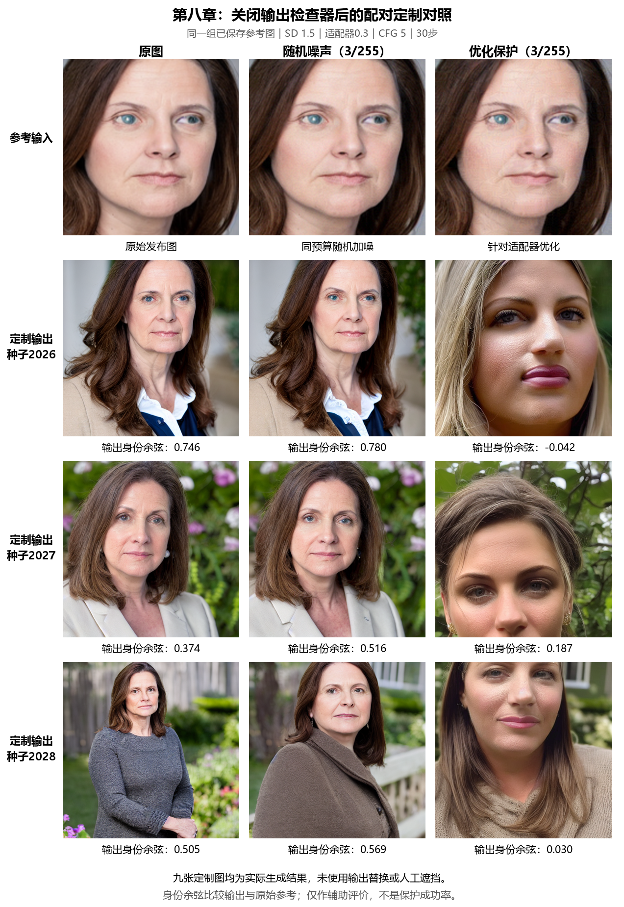

# 第8章关闭输出检查器的配对重跑（2026-10-25）

按用户要求，仅关闭生成后的输出检查器：`safety_checker=None`、`requires_safety_checker=False`。复用上一轮正式保存的原图、随机图和保护图PNG，不重新优化扰动。

其余设置固定：SD1.5、IP-Adapter Plus Face0.3、CFG5、30步、512×512、相同提示和种子2026/2027/2028。9张均为单脸可评分，检查标记为null（表示未执行检查，不表示检测为安全）。FaceNet只测量输出，不改变图片。

| 输入 | 输出数/可评分 | 输出身份余弦均值 |
|---|---:|---:|
| 原图 | 3/3 | 0.5419 |
| 随机3/255 | 3/3 | 0.6215 |
| 优化保护3/255 | 3/3 | 0.0581 |

原来未被检查器替换的8张与本次逐像素一致，确认管线变化仅影响输出检查。原黑格（保护组2026）现为实际人像，其身份余弦为-0.0423；另两张仍为0.1870和0.0296。三组参考PNG哈希与上一轮完全一致，原始数据和核验见[manifest](raw/manifest.json)与[逐样本记录](raw/outputs.json)。

读图：三列为原图/随机噪声/优化保护；首排是参考输入，后三排是相同种子下的配对输出。先检查参考图是否可用，再逐行比较定制输出对原始参考脸的保持。随机列用于判断普通加噪是否也有同样作用。保护目标是削弱参考身份复现，不要求生成失败或黑图。输出余弦是FaceNet辅助分数，不是概率或成功率；随机与优化仅匹配最大像素预算，未匹配扰动能量。本轮结果限定于该头像、提示和管线，JPEG局限见[上一轮完整验证](../privacy_ip_adapter_20261025/README.md)。

这次为独立实验预览；上一轮检查器开启的代码、书稿表图与证据保留，不与这9张混合统计。

便携运行入口为[08_privacy_checker_off.py](../../examples/controls/08_privacy_checker_off.py)，使用 `LAB_ROOT`；目录中的 `rerun.py` 保留实际执行时的原始路径和内容。
