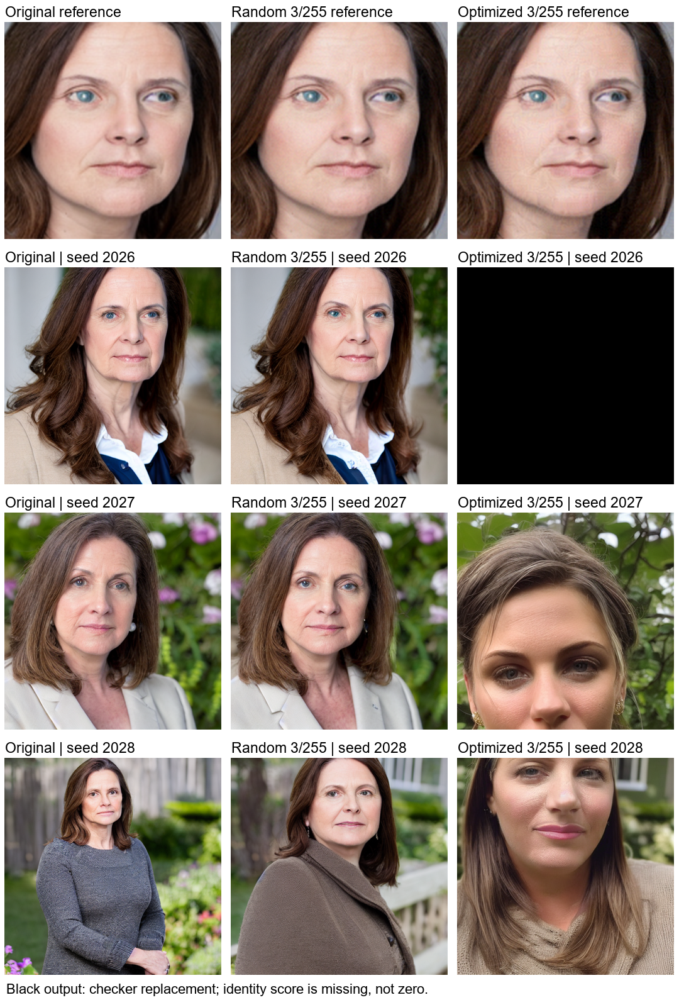

# 第8章：匹配IP-Adapter实际条件的低预算保护（2026-10-25）

本次问题定位：旧基线攻击FaceNet，但SD1.5 IP-Adapter Plus Face依赖CLIP ViT-H倒数第二层特征经Resampler形成的图像条件。FaceNet分数下降不能替代定制保护证据。本次针对实际条件优化，最大通道预算由8/255降为3/255。

## 当前书内代码与九张主结果

[当前打印代码](08_privacy.py)与[实际执行源码](executed_08_privacy.py.txt)的AST相同；两份仅规范了UTF-8 BOM、换行与结尾空行，语法树完全一致，记录见[runtime/source_normalization.json](runtime/source_normalization.json)。正式输出全部位于[formal](formal)，实际执行日志见[runtime/08_privacy_optimized_20261025.log](runtime/08_privacy_optimized_20261025.log)。

单个160×160合成成人头像；原图、随机噪声、保护PNG三条件；种子2026/2027/2028；SD1.5、Plus Face强度0.3、CFG5、30步、512×512和输出检查器固定。新保护120步，动量0.9，前90步0.5/255、后30步0.25/255；模型权重冻结。真实PIL/CLIP前向配可微bicubic近似反向；优化fp32，PNG重读后正式条件与生成fp16。

| 输入 | 最大灰度变化 | PSNR/dB | 实际条件余弦 | 可评分输出 | 输出身份余弦均值 |
|---|---:|---:|---:|---:|---:|
| 原图 | 0 | 不适用 | 1.0000 | 3/3 | 0.5419 |
| 随机噪声 | 3 | 43.15 | 0.9732 | 3/3 | 0.6215 |
| 条件优化 | 3 | 39.71 | -0.2076 | 2/3 | 0.1083 |

保护条件的2026种子被检查器替换；输出分数缺失，不记为0、不计为成功。保护均值只描述另外两张，不能与三张均值直接当作同分母成功率。配对可评分的2027/2028种子：原图均值0.4398，随机0.5425，保护0.1083。全部输出和检查标记保留；没有按视觉效果挑选种子。FaceNet未用于新方法优化，仅辅助评价，不是人工身份真值。随机与优化只匹配L∞上限，并未匹配RMS能量。

## 开发诊断与失败保留

[probe](probe)、[probe2](probe2)、[probe3](probe3)保存全部探索条件、轨迹和输出，脚本与日志均在本目录。包括旧FaceNet8/25540步、FaceNet4/255120步匹配优化器、直接条件2/3/4预算、目标条件法与随机4/255。没有把其结果拼接进正式九张主结果。

旧FaceNet8配置PSNR32.31dB、输出余弦均值0.5190，接近原图0.5419；相同120步/动量、4/255的FaceNet对照为0.5522。直接4/255条件攻击对可评分两张为-0.2647，但另有一张检查器替换；2/255的独立条件攻击均值0.4099，效果较弱。3/255作为开发样例上的折中配置，再冻结配置进行扩展验证。

probe3的3/255开发结果三张均值0.0383、无检查替换；正式打印代码独立实跑发生小数值波动，一张被替换。两次完整保留，说明固定种子不保证此GPU梯度流程逐像素一致；正式书表仅用formal结果，不挑选更好的运行。

## 配置冻结后的扩展验证

[holdout设置](holdout/settings.json)与[全部40张输出记录](holdout/outputs.json)：另两张头像作为被保护输入、studio/watercolor两条提示、2030/2031种子。face_2027曾在早期目标攻击中作为辅助目标，因此这不是严格的完全身份留出；face_2028及新提示和种子未参与前期选择。所有条件使用相同生成参数和配对随机初始化。FaceNet保持未参与新优化。

| 适配器强度 | 输入 | 样本数/可评分 | 输出身份余弦均值 |
|---|---|---:|---:|
| 0.3 | 原图 | 8/8 | 0.6598 |
| 0.3 | 随机3/255 | 8/8 | 0.6717 |
| 0.3 | 保护PNG | 8/8 | 0.1692 |
| 0.3 | 保护图JPEG75 | 8/8 | 0.6175 |
| 0.5，仅studio | 原图 | 4/4 | 0.7090 |
| 0.5，仅studio | 保护PNG | 4/4 | -0.0291 |

40张均未触发输出检查，均检测到单脸。保护PNG两头像PSNR39.65/39.68dB。JPEG显著削弱保护；JPEG重编码后最大变化不再受3/255约束（实际37/38灰度级），不能把原PNG预算约束外推给JPEG。

这是已知IP-Adapter管线的白盒逐图保护实验，不是IDProtector、TED或Anti-DreamBooth的完整复现，不证明对未知模型或真实身份普遍有效。种子不是独立身份样本，不把这些小样本平均写成显著性或成功率。

## 依据与复现记录

- [IP-Adapter官方代码](https://github.com/tencent-ailab/IP-Adapter/blob/main/ip_adapter/ip_adapter.py)：Plus条件路径。
- [Diffusers0.32.2实现](https://github.com/huggingface/diffusers/blob/v0.32.2/src/diffusers/pipelines/stable_diffusion/pipeline_stable_diffusion.py)：真实encode_image预处理与隐藏层。
- [IDProtector官方特征实现](https://github.com/showlab/IDProtector/blob/main/modules/model_instances.py)：Plus特征经Resampler投影的依据。
- [IDProtector官方可微预处理](https://github.com/showlab/IDProtector/blob/main/modules/instantid_prep_pipe.py)：bicubic/antialias/CLIP归一化参考。本实验使用独立逐图优化。

模型固定版本与权重哈希见[runtime/models.json](runtime/models.json)，环境见[runtime/pip_freeze.txt](runtime/pip_freeze.txt)。所有文件哈希与自动核验见[validation.json](validation.json)及[files_sha256.json](files_sha256.json)。
