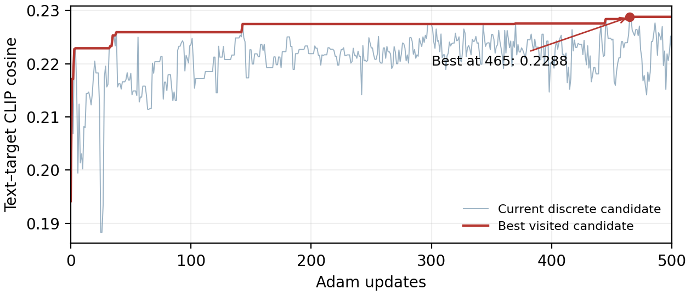

# 红杯16词元、500步优化实测（2026-10-25）

本目录是当前书内伪词实践的原始证据。使用原红杯目标。唯一GPU为A800物理0号卡，CLIP与SD1.5均使用已固定的公开模型缓存，保留SD输出检查器。

- [实际执行的82行最小代码](code/03_pseudoword.py)；与书稿及examples/minimal逐字一致。
- [独立核验入口](code/run_remote.py)、[运行状态](runtime/status.json)、[环境](runtime/environment.json)、[完整日志](runtime/run.log)。
- [词表与排除词](runtime/vocabulary.json)：24个人工核定的中性短音节，单独编码各为一个BPE ID，不含cup/mug/teacup及杯器、饮品、颜色、材质关联词。部分音节可以是人名或外语短词，不声称每个词元均无语义。
- [501条完整轨迹](pseudoword16_500/search.json)：16个位置、500次Adam更新，学习率0.1，初始化种子2026；BOS/EOS额外各1，总输入18位置。前向离散，反向ST-softmax梯度，CLIP权重冻结。
- [三次生成及两类相似度](pseudoword16_500/comparison.json)；三图同种子2026、30步、CFG7.5、512×512。
- [实际核验](runtime/acceptance.json)：501条提示全部通过CLIP/SD tokenizer的16-ID闭环，Adam状态为500，初始/最终/最佳的手工特征与原生CLIP特征最大误差均为0。

| 提示 | 图文余弦 | 生成图与目标图余弦 |
|---|---:|---:|
| 初始 | 0.1942 | 0.3570 |
| 历史最优（465步） | 0.2288 | 0.4488 |
| 自然语言参照 | 0.3244 | 0.9444 |

第500步最终分数为0.2209，低于第465步的0.2288；best.png采用历史最优而非最终状态。

实际差异：目标是偏左的俯视红杯和木桌；初始为多人头像拼图，最优为带文字样痕迹的多人场景，均未生成杯体。自然语言参照有红杯和木桌，但位置、杯柄、木纹与光照不同。共享CLIP下的余弦提升不等于目标物体出现，图像余弦不是概率；同一CLIP参与优化与测量，非独立评价。自然语言参照含目标物体词、只有8个token，不参与优化，不作为同白名单约束的公平算法基线。本例只描述一个目标、一个生成种子，不给一般成功率。

实验远端：/home/zcy/book_revision_labs_20261022/pseudoword16_500_20261025。
历史64候选与480次查询结果保留于其他日期证据目录，不与本次500次梯度更新混算。

本地86项跨文件核验及仓库结构核验见runtime/acceptance_local.json、runtime/repository_validation.json。
