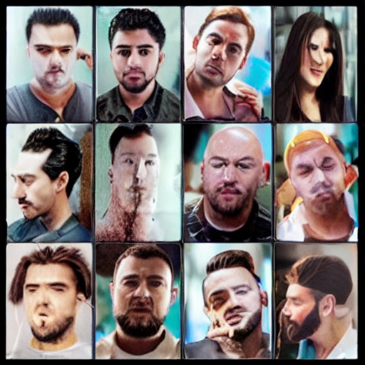
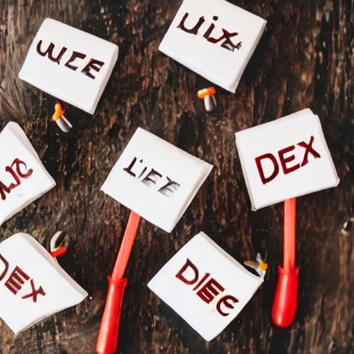
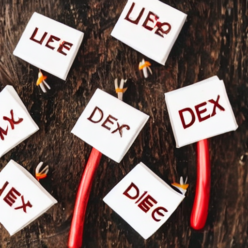
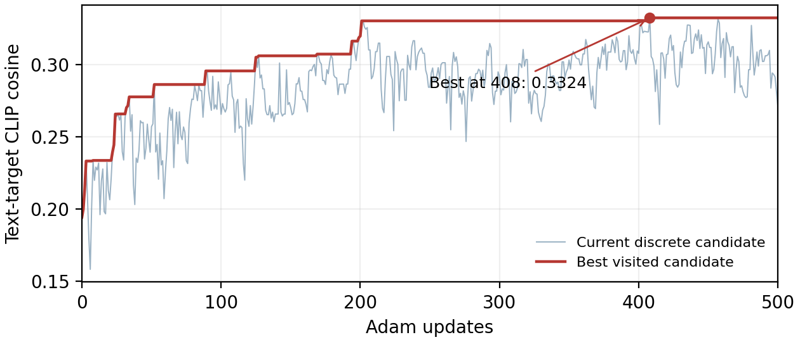

# 完整CLIP词表减黑名单：红杯16-ID、500步（2026-10-25）

当前书内伪词实践的已执行结果；仅A800物理0卡。完整词表49,408，排除2特殊ID、536黑名单命中，实际候选48,870；保留14,847个不以</w>结尾的BPE片段。没有附加英语/完整词/短音节白名单。

- [113行实际源码](code/03_pseudoword.py)，与书稿和examples/minimal逐字一致；[独立核验程序](code/run_remote.py)。
- [完整候选ID与显式黑名单](pseudoword_fullvocab/vocabulary.json)。规则为NFKC、casefold和子串匹配，例如tea也可能匹配team；不保证排除所有语义近义词。每条完整解码文本另行复查，本次501条均通过。
- [501条轨迹](pseudoword_fullvocab/search.json)：16位置，500次Adam更新，lr0.1，离散前向/ST-softmax反向，CLIP冻结。初始离散16IDs与24词元实验相同，本次连续分数初始化为0/0.1，与旧随机初始化不同。
- [原始比较数据](pseudoword_fullvocab/comparison.json)：4次生成，种子2026、30步、CFG7.5、512²，原生输出检查均False。
- [运行核验](runtime/acceptance.json)、[环境](runtime/environment.json)、[完整日志](runtime/run.log)、[源码哈希/状态](runtime/status.json)。
- [ID通路核验](runtime/id_path_baseline_verification.json)：初始ID条件图与旧标准文本初始图逐像素及文件字节相同，验证SD自身编码器条件路径。

原始16IDs先加SD tokenizer的BOS/EOS/PAD补77位，经SD1.5自身文本编码器得到77×768条件，再传prompt_embeds；没有把代理CLIP的512维投影特征当生成条件。501条只有19条可解码/重编码为原ID，最佳16IDs变15个。因此另跑最佳文本重编码，不把原ID效果当成粘贴文字的效果。best_text.roundtrip_equal检查其实际提交ID（本已重编码），不表示原16IDs闭环；原序列应看best_ids行。

| 条件 | 实际内容ID数 | 图文余弦 | 图像/目标余弦 |
|---|---:|---:|---:|
| 初始ID条件 | 16 | 0.1942 | 0.3570 |
| 最优ID条件（408步） | 16 | 0.3324 | 0.7087 |
| 最优解码文本 | 15 | 0.3303 | 0.6531 |
| 自然语言参照 | 8 | 0.3244 | 0.9444 |

初始代理0.1942，最佳0.3324（408步），最终500步0.2711。图像目标是偏左的俯视红杯与木桌；最佳ID与文本条件变为木纹背景、带文字样痕迹的白色标牌与红色杆状结构，没有红杯。自然语言参照有杯体但布局不同。代理最高分甚至高于自然语言，不能据此说生成效果更贴近目标。共享CLIP参与优化与测量，不是独立评测或成功概率；自然语言含目标词，不作为同约束公平竞争基线。

旧24词元实验及64候选搜索作为独立历史保留。远端本次目录：/home/zcy/book_revision_labs_20261022/pseudoword_fullvocab_20261025。
