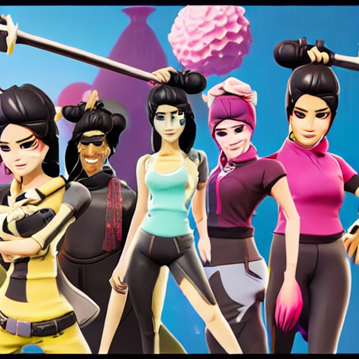

# CLIP-L/14 红杯伪词搜索：GPU0 实测（2026-10-25）

本轮使用完整 `openai/clip-vit-large-patch14`，固定版本 `32bd64288804d66eefd0ccbe215aa642df71cc41`。196项文本权重与SD1.5源权重逐项完全相同，最大绝对差0；含原生视觉分支与文本投影，未修改权重。

- [实际113行程序](code/03_pseudoword.py)；[完整核验驱动](code/run_remote.py)。书中表图只对应最小程序的四次生成，附加权重与跨版本核验由驱动完成。
- [完整候选池与黑名单](pseudoword_l14/vocabulary.json)：49,408减2特殊ID、536黑名单命中，保留48,870；含14,847非词尾BPE候选。
- [501条状态与历史最优](pseudoword_l14/search.json)：16个ID、500次Adam更新、学习率0.1，最佳第329步0.316240698，最终0.257499218，初始0.143730566。
- [实际生成条件和指标](pseudoword_l14/comparison.json)；[权重一致性](runtime/text_encoder_alignment.json)；[验收](runtime/acceptance.json)；[环境](runtime/environment.json)。
- [旧B/32结果统一用L/14重评](runtime/cross_encoder_rescore.json)。不能直接比较两个编码器各自的原始余弦。

|实际生成|内容ID数|L/14文本-目标余弦|L/14图像-目标余弦|
|---|---:|---:|---:|
|initial_ids|16|0.143730566|0.392157823|
|best_ids|16|0.316240698|0.451951295|
|best_text|17|0.270524919|0.458039641|
|natural|8|0.299474955|0.937918782|

全部固定SD1.5、种子2026、30步、CFG7.5、512²，保留输出检查器，四次标记均False。初始和自然语言参照图与前次B/32实验逐像素一致。只使用物理GPU0；实际运行32.4秒（含核验），见 [状态](runtime/status.json)。

最优两图均为游戏风格人物群像，没有杯体与木桌。自然语言参照有红杯，位置、杯柄、碟状结构和纹理不同。本次未成功重建目标。完整词表的搜索提示可含普通词、名字与片段，不保证纯造词；显式黑名单不是语义穷尽排除。相同L/14参与优化和测量，不是独立评价，也不报告安全绕过率。

47/501状态可decode/reencode精确闭环；最佳16IDs变17，最后原始10680变85、6259。`best_ids`的roundtrip_equal=False；`best_text`该字段只比较其实际提交的重编码ID，不能理解为原始ID闭环。

旧B/32最优ID在L/14下：文本-目标0.210089266、图像-目标0.658630013；本轮分别0.316240698、0.451951295。对齐文本编码器不保证实际生成改善。相同黑名单、初始ID、连续分数初始化、优化参数与SD采样参数；仅一目标一初始化一采样种子，不作算法统计结论。旧证据保留在相邻有日期目录。

复现：先从仓库根目录配置LAB_ROOT，运行 `python experiments/a800/download_models.py sd15 clip_l14`，复制 `examples/book/assets/pseudoword_target.png` 至 `$LAB_ROOT/inputs/`，再执行 `python examples/minimal/03_pseudoword.py`；可选 `python tools/plot_pseudoword_l14.py`。输出在 `$LAB_ROOT/pseudoword_l14/`。
